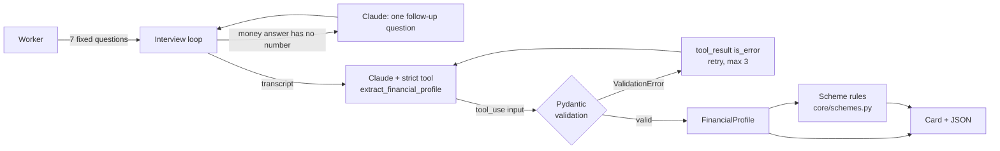

# InformalID

[](https://github.com/rakshithmuda22/informalid/actions/workflows/ci.yml)


**A seven-question conversation turns a cash-only worker's own words into a validated financial profile, then screens it against the government schemes they may be entitled to.**

Built on the Claude API (tool use), Pydantic and plain-Python eligibility rules.

## The problem

About 490 million people in India work in the informal economy: 90.3% of the 544.5 million people employed in 2022, by the ILO and IHD's *India Employment Report 2024* (Table 2.2; the product is my arithmetic). They are paid in cash, so there are no payslips or bank statements for a lender or a scheme office to read.

Schemes built for them exist, and many are tied to a bank account or a registration the worker may not have. [e-Shram](https://eshram.gov.in) alone has 31.82 crore (318 million) workers registered (PIB, 3 Aug 2026). PM SVANidhi has made 112 lakh loans worth more than Rs 17,800 crore to 75.5 lakh street vendors (PIB, 30 May 2026). Each scheme has its own age band, income cap, documents and prerequisites, and working out which ones apply to a given person is manual work.

## What it does

1. Asks seven fixed questions (identity, work, income, expenses, bank/Aadhaar/phone, history, references).
2. If a money answer has no number in it, Claude writes one short follow-up question.
3. Sends the transcript to Claude with a `strict` tool whose schema is the `FinancialProfile` Pydantic model. The tool input is validated; if it is invalid the error goes back to Claude as an `is_error` tool result and it tries again (up to 3 attempts).
4. Runs the validated profile through a rules engine (`core/schemes.py`, no model call) that lists the schemes the worker is likely eligible for, what is missing for the rest, and what an officer must still confirm.

It is a screening and intake aid. It is not a credit score and it does not decide eligibility.

## Example

Offline run of `python demo/demo.py --persona vendor` (the worker's answers and the extraction are scripted, see [Offline mode](#offline-mode); the schemes list is the real rules engine):

```
[InformalID] How much money do you earn in a typical month? Do you earn from any other sources too?
[Ramesh Kumar] Business is okay. Good months are better and the rainy season is less. My wife also does some stitching work.
[InformalID] Roughly how many rupees does the stall bring in during a good month, and during the rainy season?
[Ramesh Kumar] On a good month I earn about 18,000 to 20,000 rupees. Rainy season is less, maybe 12,000. My wife's stitching is maybe 3,000 per month.
...
  Total monthly income:   Rs 21,000
  Monthly expenses:       Rs 18,000
  Monthly savings:        Rs 3,000

  LIKELY ELIGIBLE SCHEMES (7) - confirm the flagged items
  ✓ e-Shram Registration
  ✓ Jan Dhan Overdraft Facility - up to Rs 10,000
  ✓ PM SVANidhi - Street Vendor Micro Loan (Tranche 1) - up to Rs 15,000
    Confirm: Needs a Certificate of Vending or Letter of Recommendation from the Urban Local Body.
  ✓ MUDRA Shishu Loan - up to Rs 50,000
  ✓ MUDRA Kishore Loan - up to Rs 5,00,000
  ✓ PMSBY - Accident Insurance - up to Rs 2,00,000
  ✓ PMJJBY - Life Insurance - up to Rs 2,00,000

  AFTER PREREQUISITES / TO VERIFY (2)
  ○ PM SVANidhi UPI-linked RuPay Credit Card - up to Rs 30,000
    Why not yet: Unlocks only after the second SVANidhi loan (Rs 25,000) is repaid.
  ○ PM-JAY (Ayushman Bharat) - Health Cover - up to Rs 5,00,000
```

The first persona, a domestic worker with no bank account, shows why the bank account comes first. Only 2 schemes are likely now, and the card says:

```
  Opening a bank account would unlock: PMSBY - Accident Insurance; PMJJBY - Life Insurance;
  PM-SYM - Shram Yogi Maan-dhan Pension; APY - Atal Pension Yojana.
```

The profile is also available as validated JSON (`python demo/demo.py --json`).

## Quickstart

```bash
git clone https://github.com/rakshithmuda22/informalid.git
cd informalid
python -m venv .venv && source .venv/bin/activate
pip install -r requirements.txt

python demo/demo.py                    # offline: no API key, both personas
python demo/demo.py --persona vendor   # one persona
```

To run a real interview (you type the answers, Claude does the follow-up and extraction):

```bash
cp .env.example .env     # set ANTHROPIC_API_KEY
python demo/demo.py
```

`INFORMALID_MODE` is `auto` by default (live if a key is set, otherwise offline); set `live` or `mock` to force it. `CLAUDE_MODEL` defaults to `claude-sonnet-5-5`; `claude-opus-5-5` and `claude-haiku-5-5` also work.

## How it works



- **Fixed questions, model-written extraction.** Every profile covers the same ground and the model cannot skip a field. Claude is used where language is messy: the follow-up, and turning "around eight to nine thousand" into numbers.
- **One schema, three jobs.** `FinancialProfile` is the tool's `input_schema` (via `anthropic.transform_schema`), the validator for what comes back, and the typed record the rest of the code reads. It has ranges, enums, `extra="forbid"` and a savings-cannot-exceed-income rule.
- **No forced tool choice.** Current Claude models reject `tool_choice: {"type": "tool"}`, so the code leaves it on `auto`, marks the tool `strict`, and checks that a call was actually made.
- **Eligibility is code, not a prompt.** The model is told not to name schemes or amounts, so the rules in `core/schemes.py` are the single source of truth. Each scheme is a testable function of the profile with its sources listed in the module docstring.
- **Honest about what an interview can't show.** Each match can carry a `verify` line for what an officer must confirm (a Certificate of Vending, no EPFO/ESIC membership, SECC-2011 listing for PM-JAY).

### Schemes covered

| Scheme | Rule encoded | Primary source |
|---|---|---|
| e-Shram | age 16+, Aadhaar; not EPFO/ESIC or income-tax payer (flagged to confirm) | eshram.gov.in FAQ; PIB 3 Aug 2026 |
| PM SVANidhi | street vendor; Rs 15,000 / 25,000 / 50,000 tranches; 7% interest subsidy; RuPay credit card (up to Rs 30,000) after the second loan is repaid | PIB 27 Aug 2025, 30 May 2026 |
| PM Vishwakarma | one of the 18 listed trades, self-employed; Rs 1 lakh then Rs 2 lakh at 5% | PIB 20 Sep 2023 |
| MUDRA Shishu / Kishore | self-employed; Shishu up to Rs 50,000, Kishore to Rs 5 lakh (the 3-year / Rs 10,000 screen for Kishore is this tool's heuristic and is labelled as such) | MUDRA tiers (secondary sources) |
| PM-SYM | age 18-40, income up to Rs 15,000, bank account and Aadhaar; Rs 3,000/month pension at 60 | PIB 4 Mar 2025 |
| APY | age 18-40, bank account; not an income-tax payer | PIB 9 May 2023 |
| PMSBY / PMJJBY | age 18-70 / 18-50, bank account; Rs 20 / Rs 436 a year for Rs 2 lakh cover | PIB 9 May 2023 |
| PM Jan Dhan | open an account, or the overdraft of up to Rs 10,000 for eligible holders (conditions flagged) | pmjdy.gov.in; overdraft conditions from bank pages |
| PM-JAY | always "to verify": eligibility comes from the SECC-2011 household list, not from an interview | secondary sources |

Amounts and rules were checked in October 2026 and will drift; re-check `core/schemes.py` against the sources before any real use.

### Offline mode

`core/mock.py` provides `ScriptedClient`, a stand-in for `anthropic.Anthropic()` that returns real SDK `Message` objects, so the offline run exercises the same code as the live run: question loop, follow-up, tool-use request, validation, retry, scheme matching and card. It also rejects requests the current API would reject (forced `tool_choice`, a first message that is not from the user, a `tool_use` with no `tool_result`).

What it does not do: the "extraction" it returns is each persona's hand-written profile, not a model reading the transcript. It tests the plumbing, not extraction quality.

## Tests and CI

```bash
pip install -r requirements-dev.txt
pytest tests/ -q                       # 127 passed
flake8 config.py core demo tests --max-line-length=120 --ignore=E501,W503
```

CI (`.github/workflows/ci.yml`) runs lint, the tests on Python 3.11 and 3.12, and the offline demo. No API key is needed anywhere.

Besides unit tests of the models, rules (age and income boundaries, occupation matching) and formatter, `tests/test_wire_format.py` drives the real `anthropic` SDK client against an in-process HTTP transport. That checks the exact JSON that would be sent to `POST /v1/messages` (strict tool, `tool_choice`, `output_config`, the `tool_result` retry turn) and that a response containing a thinking block before the text is parsed correctly.

## Limitations and roadmap

- **Not yet run against the live API in this repo.** There is no key in CI. The request and response shapes are tested at the SDK transport level, but extraction quality on real, messy answers is unmeasured. Next step: a small labelled set of transcripts and a field-level accuracy score.
- **English only.** Questions and the follow-up are in English. Claude can converse in Indian languages, but the question templates and prompts are not translated, and nothing here has been tested in them.
- **Self-reported and unverified.** The card says so, and `verify` lines say what an officer must check.
- **Scheme rules are a snapshot** (October 2026) and are maintained by hand. PM-SYM/APY/PMSBY figures come from PIB releases of 2023-2025; confirm premiums before use.
- **Household vs individual income.** PM-SYM limits are individual; the profile has a household total, so the check is conservative.
- **Privacy.** In live mode the transcript (name, income, bank status) is sent to the Anthropic API. This tool stores nothing, but a real deployment needs consent and a data-handling policy.
- **Printable output.** A PDF card with a QR code to the JSON record would suit field officers.

## Sources

- ILO and IHD, *India Employment Report 2024*, Table 2.2 and Figure 2.2 (544.5 million workforce, 90.3% informal employment, 2022).
- PIB: Cabinet restructuring of PM SVANidhi (27 Aug 2025); PM SVANidhi backgrounder (30 May 2026); e-Shram written reply (3 Aug 2026); PM-SYM (4 Mar 2025); PMJJBY, PMSBY and APY (9 May 2023); PM Vishwakarma salient features (20 Sep 2023).
- eshram.gov.in FAQs; pmjdy.gov.in.

MIT licence.
